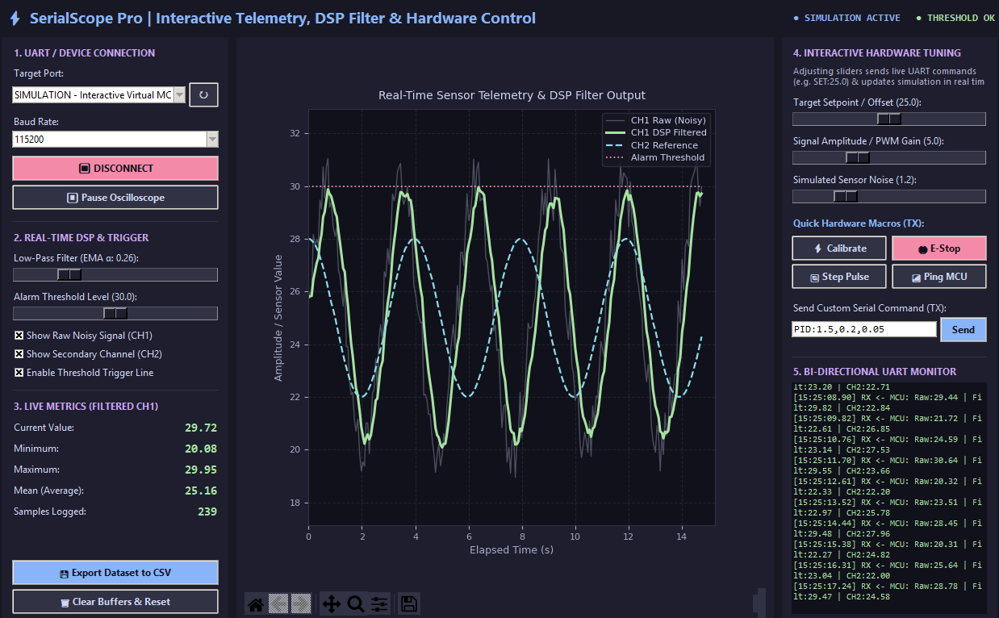

# SerialScope Pro

**Interactive UART Telemetry, Real-Time DSP Filter & Hardware Control Tool**



## Why I Built This

As a 3rd-year Electrical and Electronics Engineering student, I spend a lot of time working with microcontrollers (Arduino, ESP32, STM32) for control systems and sensor interfacing labs. 

While debugging projects, I kept running into two annoying problems with standard Serial Monitors and basic plotters:
1. **Noisy sensor data:** Raw ADC readings often have high-frequency noise, and testing a simple low-pass filter usually meant changing the C/C++ code and reflashing the microcontroller over and over.
2. **Tuning parameters on the fly:** When testing a PID controller or changing a target setpoint, I wanted a clean way to slide a value on my PC and immediately see the system's step response on the graph without stopping the stream.

I built **SerialScope Pro** in Python to solve both of these problems in a single desktop tool. Even if you don't have a microcontroller plugged in right now, it includes a built-in **Virtual MCU Simulation Mode** so you can test the DSP filtering and control features right away.

---

## Main Features

* **Real-Time Low-Pass DSP Filter (EMA):** You can smooth out noisy incoming data in real time using the alpha slider on the left panel. It plots both the raw noisy signal (`CH1 Raw`) and the filtered output (`CH1 DSP Filtered`) on the same axes so you can compare them directly.
* **Interactive Hardware Tuning (TX):** Moving the sliders on the right panel immediately sends clean ASCII commands (like `SETPOINT:25.0` or `GAIN:5.0`) over UART to your microcontroller. There are also quick macro buttons for step-response testing (`Step Pulse`), calibration, and emergency stop (`E-Stop`).
* **Threshold Alarm & Trigger Line:** Includes an adjustable horizontal threshold line. If the filtered signal crosses your limit, the top status bar triggers a visual alarm.
* **Built-In Virtual MCU Simulator:** Generates a live noisy sine wave + reference channel out of the box. You can inject noise, change amplitude, or trigger a step pulse to see how the filter reacts without any hardware connected.
* **One-Click CSV Export:** Saves your recorded session (Timestamps, Elapsed Time, Raw CH1, Filtered CH1, and CH2) directly to a `.csv` file for plotting in MATLAB, Excel, or Python.

---

## How to Run It

### 1. Clone or Download the Repository
```bash
git clone https://github.com/YOUR_USERNAME/SerialScope-Pro.git
cd SerialScope-Pro
```

### 2. Install Required Libraries
This project only uses `pyserial` for UART communication and `matplotlib` for plotting (`tkinter` comes pre-installed with Python).
```bash
pip install -r requirements.txt
```

### 3. Run the Application
```bash
python serial_scope.py
```
*Note: To test it without hardware, leave the port set to **SIMULATION - Interactive Virtual MCU & Sensor** and click **CONNECT & STREAM**.*

---

## Microcontroller Serial Format (RX / TX)

If you want to hook up your own Arduino, ESP32, or STM32, the parser is kept simple so it works with standard `Serial.println()` statements.

### Sending Data from MCU to PC (RX)
Send newline-terminated (`\n`) values separated by a comma:
* **Single Channel:** `25.40`
* **Two Channels (CH1 and CH2):** `25.40,22.10`
* **Key-Value Format:** `RAW:25.40,REF:22.10`

### Reading Commands from PC to MCU (TX)
When you adjust the sliders or click macro buttons in the app, it sends strings ending with `\n` over serial:
* `SETPOINT:25.0`
* `GAIN:5.0`
* `STEP:35.0`
* `CMD:CALIBRATE` / `CMD:ESTOP` / `CMD:PING`
* Or any custom string you type into the command box (e.g., `PID:1.5,0.2,0.05`).

---

## Built With

* **Python 3**
* **Tkinter (ttk)** - Custom dark UI layout
* **Matplotlib** - Embedded real-time oscilloscope canvas & zoom/pan toolbar
* **PySerial** - UART port scanning and serial communication
* **Threading & Deque** - Background serial reading thread so the GUI never freezes

---

## License

This project is open-source under the MIT License. Feel free to use, modify, or adapt it for your own embedded systems labs and student projects!